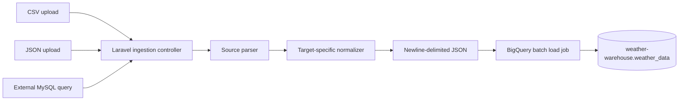

# Weather Warehouse ETL Ingestion Portal

This application is the ingestion boundary for the Weather Warehouse. It accepts semi-structured data from flat files and external MySQL databases, cleans the records into the shape expected by BigQuery, and loads them into the appropriate warehouse dimension table.

The application currently supports these ingestion targets:

| Source | BigQuery table | Destination purpose |
| --- | --- | --- |
| MySQL query | `dim_sensor_hardware` | Sensor hardware status and telemetry metadata |
| CSV upload | `dim_emergency_shelters` | Emergency shelter locations and capacity |
| JSON upload | `dim_district_demographics` | District population and vulnerability metrics |

The portal does not store external MySQL credentials. They are used for one request, and the connection is closed when the request finishes.

## Architecture



The main code paths are:

```text
routes/web.php
  -> IngestionController
      -> IngestionPreviewService
          - parses CSV, JSON, or MySQL results
      -> BigQueryIngestionService
          - validates and normalizes rows
          - starts a BigQuery load job
```

## Technology Stack

- PHP 8.5
- Laravel 13
- Tailwind CSS 4 and Vite
- MySQL through native PDO
- Google Cloud BigQuery PHP client (`google/cloud-bigquery`)
- Pest feature tests

## Prerequisites

Install the following before running the portal:

- PHP 8.3 or newer
- Composer
- Node.js and npm
- PHP `pdo_mysql` extension for external MySQL connections
- A Google Cloud project with BigQuery enabled
- A Google Cloud service account or Application Default Credentials
- A BigQuery dataset containing the destination tables

The project has been tested with the Google Cloud project ID `weather-warehouse` and dataset `weather_data`, but both values are configurable.

## Installation

```bash
git clone <repository-url>
cd etl-ingestion-portal

composer install
cp .env.example .env
php artisan key:generate

npm install
php artisan migrate --force
npm run build
```

For local development, start the Laravel and Vite processes with:

```bash
composer run dev
```

The default local URL is:

```text
http://localhost:8000
```

## Environment Configuration

Add the BigQuery settings to `.env`:

```dotenv
GOOGLE_CLOUD_PROJECT_ID=weather-warehouse
GOOGLE_BIGQUERY_DATASET=weather_data
GOOGLE_APPLICATION_CREDENTIALS=/absolute/path/to/weather-warehouse-service-account.json
```

`GOOGLE_APPLICATION_CREDENTIALS` must point to a readable service-account JSON file. Do not commit this file or paste its private key into source control.

After changing environment values while the development server is running, clear cached configuration:

```bash
php artisan config:clear
```

### Required Google Cloud permissions

The service account needs permission to submit load jobs and write to the target dataset. A practical dataset-level setup is:

- BigQuery Job User on the project
- BigQuery Data Editor on the `weather_data` dataset

The BigQuery API must also be enabled for the project:

```bash
gcloud services enable bigquery.googleapis.com \\
    --project=weather-warehouse
```

## BigQuery Tables

The portal writes to the following tables. These tables must already exist before an upload is attempted.

### Sensor hardware

```sql
CREATE OR REPLACE TABLE `weather-warehouse.weather_data.dim_sensor_hardware` (
  hardware_id INT64,
  location_id STRING,
  sensor_type STRING,
  battery_level_pct INT64,
  status STRING,
  ingested_at TIMESTAMP
);
```

This destination is populated from the external MySQL table `sensor_hardware_status`.

### Emergency shelters

```sql
CREATE OR REPLACE TABLE `weather-warehouse.weather_data.dim_emergency_shelters` (
  location_id STRING,
  shelter_name STRING,
  capacity INT64,
  has_backup_power BOOL
);
```

This destination is populated from CSV files such as `sample/shelters.csv`.

### District demographics

```sql
CREATE OR REPLACE TABLE `weather-warehouse.weather_data.dim_district_demographics` (
  location_id STRING,
  population_density_km2 INT64,
  vulnerable_elderly_pct FLOAT64
);
```

This destination is populated from a JSON object or an array of JSON objects.

## Source Data Flow

Every upload follows the same high-level sequence:

1. The browser submits a file or MySQL connection form using `fetch()` and a CSRF token.
2. Laravel validates the request shape.
3. The source service parses the input into an array of associative PHP rows.
4. The BigQuery service selects a destination-specific normalizer.
5. Each row is trimmed, type-converted, validated, and mapped to the destination schema.
6. The normalized rows are encoded as newline-delimited JSON.
7. Laravel starts a BigQuery load job with `WRITE_APPEND`.
8. The UI displays the destination table and number of inserted rows.

The application uses a BigQuery load job instead of `insertRows()`. This matters because streaming inserts are not available in some BigQuery free-tier projects. Batch loading also fits the ETL workflow better because the full source batch is cleaned before it is sent to BigQuery.

## CSV Ingestion

CSV files must:

- Have a `.csv` extension.
- Be no larger than 10 MB.
- Use the first row as the column header.
- Contain one record per subsequent row.

Example:

```csv
location_id,shelter_name,capacity,has_backup_power
LK-11,Colombo Central College,1500,true
LK-21,Kandy Municipal Hall,800,false
```

The parser trims header names and creates an associative row:

```php
[
    'location_id' => 'LK-11',
    'shelter_name' => 'Colombo Central College',
    'capacity' => '1500',
    'has_backup_power' => 'true',
]
```

The shelter normalizer then converts it to the BigQuery-compatible representation:

```php
[
    'location_id' => 'LK-11',
    'shelter_name' => 'Colombo Central College',
    'capacity' => 1500,
    'has_backup_power' => true,
]
```

For shelter rows, `location_id`, `shelter_name`, `capacity`, and `has_backup_power` are required. Accepted boolean values include `true`, `false`, `1`, `0`, `yes`, `no`, `on`, and `off`.

## JSON Ingestion

The JSON parser accepts either one object:

```json
{
  "location_id": "LK-11",
  "population_density_km2": "1250",
  "vulnerable_elderly_pct": "8.75"
}
```

Or an array of objects:

```json
[
  {
    "location_id": "LK-11",
    "population_density_km2": "1250",
    "vulnerable_elderly_pct": "8.75"
  },
  {
    "location_id": "LK-21",
    "population_density_km2": "620",
    "vulnerable_elderly_pct": "10.20"
  }
]
```

The demographics normalizer converts numeric strings before upload:

```php
[
    'location_id' => 'LK-11',
    'population_density_km2' => 1250,
    'vulnerable_elderly_pct' => 8.75,
]
```

The JSON document must contain objects with named fields. Scalar arrays, invalid JSON, and malformed rows are rejected.

## MySQL Database Ingestion

The database form accepts:

- Host
- Port
- Database name
- Username
- Password
- Custom SQL query

For the provided MySQL initialization script, use:

```sql
SELECT * FROM sensor_hardware_status;
```

The source table contains:

```sql
CREATE TABLE sensor_hardware_status (
    id INT PRIMARY KEY AUTO_INCREMENT,
    location_id VARCHAR(50) NOT NULL,
    sensor_type VARCHAR(50) NOT NULL,
    battery_level_pct INT NOT NULL,
    status VARCHAR(20) NOT NULL
);
```

The MySQL-to-BigQuery mapping is:

| MySQL source | BigQuery destination | Transformation |
| --- | --- | --- |
| `id` | `hardware_id` | Integer conversion and rename |
| `location_id` | `location_id` | Trimmed required string |
| `sensor_type` | `sensor_type` | Trimmed required string |
| `battery_level_pct` | `battery_level_pct` | Integer conversion |
| `status` | `status` | Trimmed required string |
| Not present | `ingested_at` | Current UTC timestamp |

For example, this MySQL row:

```text
id: 1
location_id: LK-11
sensor_type: Rain Gauge
battery_level_pct: 92
status: Online
```

becomes:

```json
{
  "hardware_id": 1,
  "location_id": "LK-11",
  "sensor_type": "Rain Gauge",
  "battery_level_pct": 92,
  "status": "Online",
  "ingested_at": "2026-10-31T09:30:00+00:00"
}
```

### MySQL connection behavior

The application creates a temporary PDO connection with:

```php
new PDO(
    'mysql:host='.$host.';port='.$port.';dbname='.$database.';charset=utf8mb4',
    $username,
    $password,
    [
        PDO::ATTR_ERRMODE => PDO::ERRMODE_EXCEPTION,
        PDO::ATTR_DEFAULT_FETCH_MODE => PDO::FETCH_ASSOC,
        PDO::ATTR_TIMEOUT => 5,
    ],
);
```

Only queries beginning with `SELECT`, `SHOW`, `DESCRIBE`, `DESC`, or `EXPLAIN` are accepted. Mutating statements such as `INSERT`, `UPDATE`, `DELETE`, `DROP`, and `ALTER` are rejected by the application.

The source credentials are not written to `.env`, the database, logs, or the browser response.

## Data Preparation Rules

The preparation layer is implemented in `BigQueryIngestionService` and runs before any BigQuery request.

### Required values

Missing required fields stop the entire batch with a row-specific error:

```text
Row 1 is missing location_id.
```

### Strings

String fields are trimmed so values such as `" LK-11 "` become `"LK-11"`.

### Integers

Numeric strings are converted to PHP integers:

```text
"1500" -> 1500
"92"   -> 92
```

Non-numeric values are rejected:

```text
Row 1 has an invalid integer in capacity.
```

### Floating-point numbers

Demographic percentages and other decimal values are validated with `is_numeric()` and converted to PHP floats:

```text
"8.75" -> 8.75
```

### Booleans

The shelter normalizer accepts common source representations:

```text
true, 1, yes, y, on   -> true
false, 0, no, n, off  -> false
```

### Timestamps

Sensor rows do not contain `ingested_at`, so the service creates the current timestamp and converts it to UTC ISO-8601 format before the BigQuery load.

## BigQuery Load Process

The service builds one JSON object per line:

```json
{"location_id":"LK-11","shelter_name":"Colombo Central College","capacity":1500,"has_backup_power":true}
{"location_id":"LK-21","shelter_name":"Kandy Municipal Hall","capacity":800,"has_backup_power":false}
```

It then creates a BigQuery load configuration:

```php
$job = $client->runJob(
    $table->load($jsonLines)
        ->sourceFormat('NEWLINE_DELIMITED_JSON')
        ->writeDisposition('WRITE_APPEND'),
);
```

`WRITE_APPEND` means new rows are added to the existing table. The current implementation does not deduplicate records. Uploading the same file or running the same MySQL query twice can therefore create duplicate rows.

## HTTP Routes

| Method | Route | Purpose |
| --- | --- | --- |
| `GET` | `/` | Render the ingestion workspace |
| `POST` | `/ingestion/file-preview` | Parse a CSV/JSON file and return the first five rows |
| `POST` | `/ingestion/database-preview` | Execute a read-only MySQL query and return the first five rows |
| `POST` | `/ingestion/file-upload` | Normalize and upload a CSV/JSON file to BigQuery |
| `POST` | `/ingestion/database-upload` | Normalize and upload MySQL query results to BigQuery |

All POST routes are protected by Laravel’s web middleware and CSRF protection.

Example file upload request:

```bash
curl -X POST http://localhost:8000/ingestion/file-upload \\
  -H "Accept: application/json" \\
  -H "X-CSRF-TOKEN: <csrf-token>" \\
  -F "file=@sample/shelters.csv" \\
  -F "target_table=dim_emergency_shelters"
```

Successful upload response:

```json
{
  "target": "dim_emergency_shelters",
  "inserted": 4,
  "rows": [
    {
      "location_id": "LK-11",
      "shelter_name": "Colombo Central College",
      "capacity": 1500,
      "has_backup_power": true
    }
  ],
  "total": 4
}
```

## Error Handling

Expected validation or transformation failures return HTTP `422` with a safe message. Examples include:

```text
Only CSV and JSON files are supported.
The source returned no rows to upload.
Row 1 is missing hardware_id.
Row 1 has an invalid integer in capacity.
Only read-only SQL statements are allowed for previewing data.
```

BigQuery and MySQL details are intentionally not exposed directly to the browser. BigQuery failures are logged server-side with the target table, row count, and provider error, while the browser receives a generic actionable message.

Inspect the application log locally with:

```bash
tail -f storage/logs/laravel.log
```

## Testing

Run the focused ingestion tests:

```bash
php artisan test --compact tests/Feature/IngestionTest.php
```

The test suite covers:

- Ingestion workspace availability.
- CSV preview behavior.
- File-type validation.
- Read-only SQL enforcement.
- Shelter type conversion.
- Demographic numeric conversion.
- MySQL `id` to BigQuery `hardware_id` mapping.
- Automatic sensor ingestion timestamps.
- Invalid source values being rejected before upload.

Format PHP files with Laravel Pint:

```bash
vendor/bin/pint --format agent
```

Build the production frontend:

```bash
npm run build
```

## Troubleshooting

### `BigQuery batch upload failed`

Check the following:

1. `GOOGLE_CLOUD_PROJECT_ID` is the actual Google Cloud project ID.
2. `GOOGLE_BIGQUERY_DATASET` matches the dataset name.
3. `GOOGLE_APPLICATION_CREDENTIALS` points to a readable JSON file.
4. The BigQuery API is enabled.
5. The service account has BigQuery Job User and dataset write access.
6. The destination table exists with the expected columns and types.
7. Run `php artisan config:clear` after editing `.env`.

### `Row 1 is missing hardware_id`

The MySQL source table uses `id`, and the service maps it automatically. If a custom query renames or removes that column, either include `id`:

```sql
SELECT * FROM sensor_hardware_status;
```

or alias it explicitly:

```sql
SELECT
    id AS hardware_id,
    location_id,
    sensor_type,
    battery_level_pct,
    status
FROM sensor_hardware_status;
```

### MySQL connection errors

Check that:

- The host is reachable from the Laravel server.
- Port `3306` is open to the Laravel server.
- The MySQL user has permission to read the selected table.
- PHP has the `pdo_mysql` extension installed.
- The query is read-only and begins with an accepted read keyword.

### Duplicate rows

The current load disposition is `WRITE_APPEND`. Do not upload the same source batch repeatedly unless duplicate records are acceptable. A future production enhancement should add a staging table plus a `MERGE` statement keyed by a business identifier such as `hardware_id` or `location_id`.
